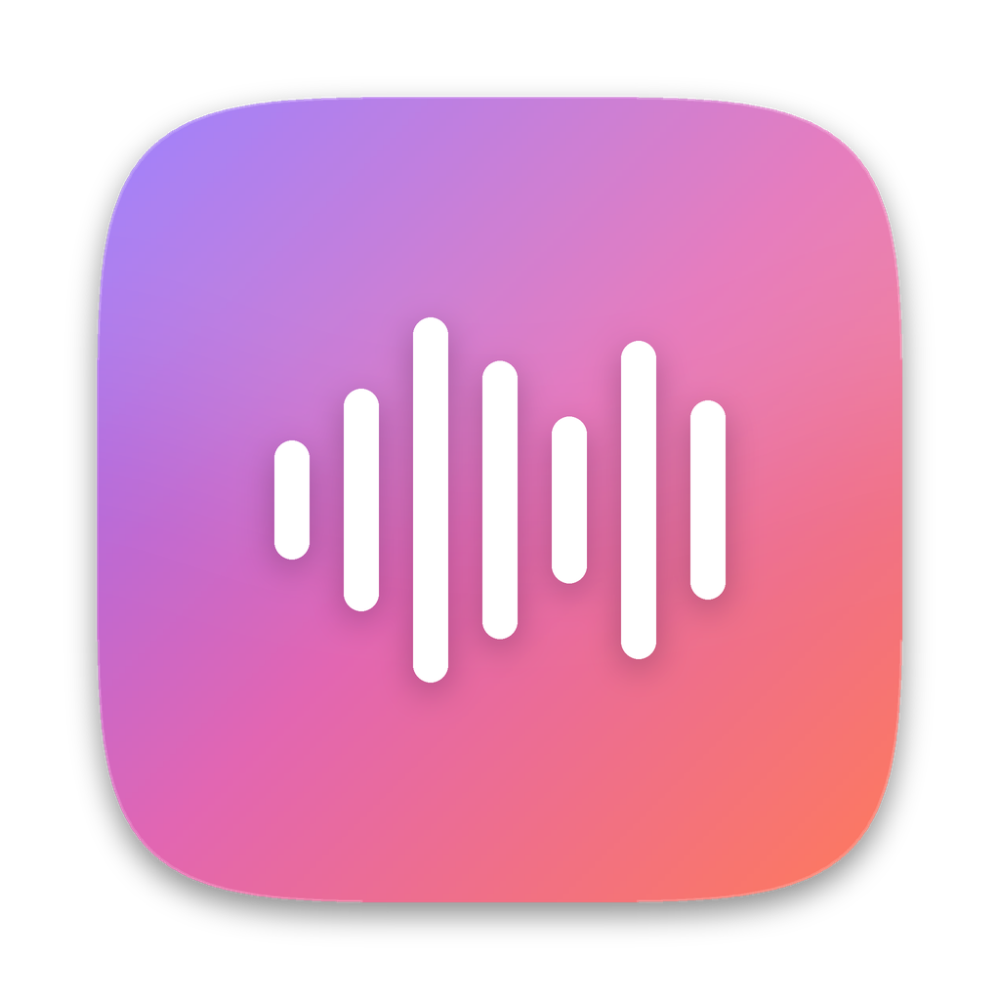
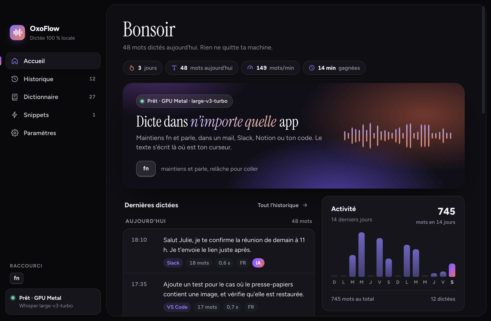
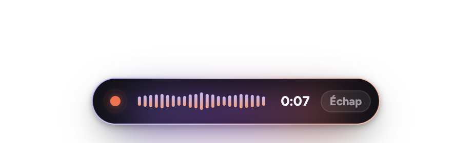
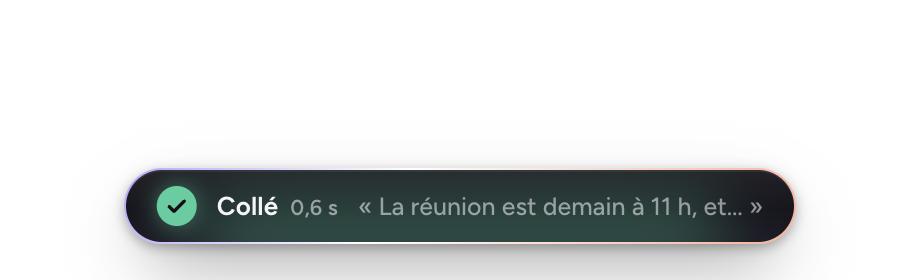
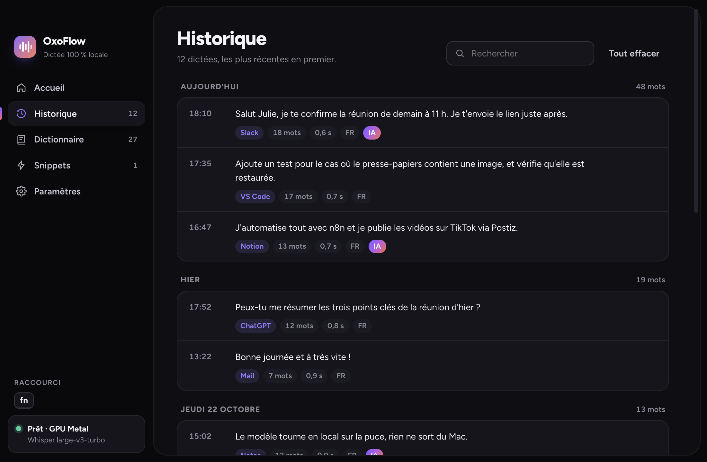
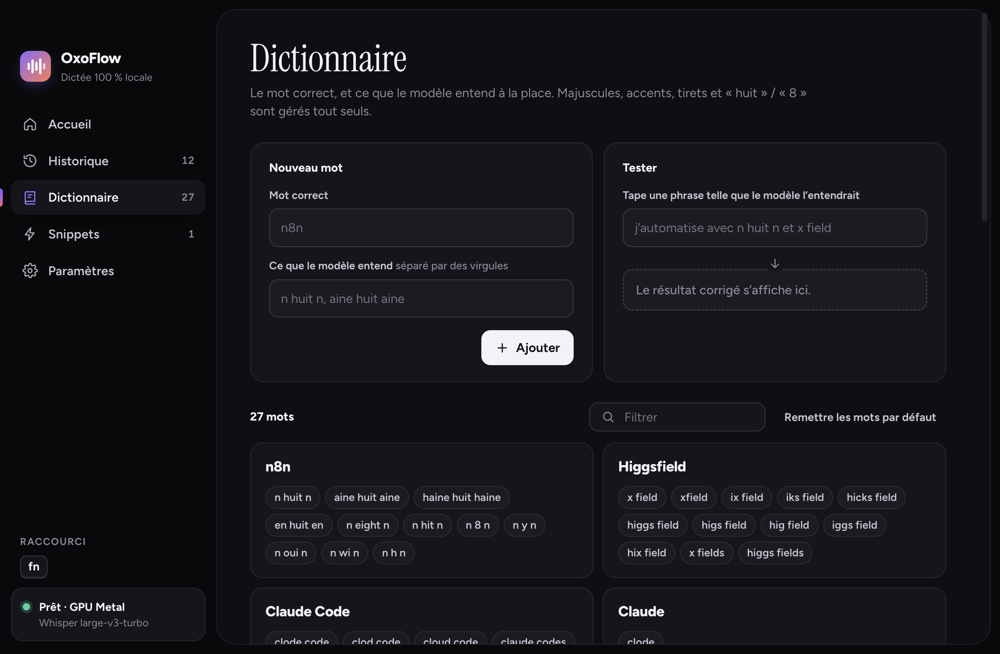

<p align="center"></p>

<h1 align="center">FreeFlow</h1>

<p align="center"><b>La dictée vocale 100 % locale pour Windows.</b><br>
Un raccourci, tu parles, le texte s'écrit là où se trouve ton curseur.<br>
Gratuit, open source, sans compte, sans abonnement, et rien ne quitte ton PC.</p>

<p align="center"><a href="https://github.com/AlanECE/freeflow/releases/latest/download/FreeFlow-Setup.exe"><b>⬇ Télécharger FreeFlow pour Windows</b></a></p>

<p align="center"></p>

## Ce que ça fait

- **Dictée partout** : dans un mail, Notion, Slack, ChatGPT, VS Code… Appuie sur `Ctrl + Alt + Espace`, parle, appuie à nouveau : le texte est collé là où tu écris.
- **Deux façons de dicter** : un appui pour démarrer puis un appui pour arrêter (mains libres), ou garder la touche enfoncée pendant que tu parles (push-to-talk). Le raccourci se change dans Paramètres (bouton *Enregistrer* puis *Confirmer*) ; les combinaisons de touches de modification seules marchent aussi (ex. `Ctrl + Win`).
- **Transcription locale** : le modèle Whisper `large-v3` tourne sur ta carte graphique NVIDIA (moins d'une seconde pour 10 secondes de voix sur une RTX récente). Sans carte NVIDIA, FreeFlow passe tout seul sur le processeur avec un modèle plus léger.
- **Vocabulaire** : apprends-lui tes mots. « n huit n » devient `n8n`, « x field » devient `Higgsfield`. Pour chaque mot, tu indiques ce que le modèle entend à la place ; un champ de test montre la correction en direct.
- **Snippets** : un mot déclencheur remplacé par un texte (ton adresse, une signature, un lien…).
- **Mise en forme** : les « euh » et « hum » sont retirés, les majuscules, les espaces avant `? ! ; :` et la casse de tes mots sont corrigées.
- **Historique** : toutes tes dictées regroupées par jour, avec recherche, l'application cible, le temps de transcription et la transcription brute avant mise en forme.
- **Tableau de bord** : mots du jour, vitesse, série de jours, activité sur 14 jours et temps gagné (estimation face à une frappe à 40 mots/min).
- **Annuler** : `Échap` pendant l'écoute abandonne la dictée ; la pastille affiche la durée et prévient 30 s avant la limite.
- **Thème clair ou sombre**, qui suit Windows par défaut.
- **Vie privée** : une fois le modèle téléchargé, FreeFlow n'a plus besoin d'Internet. Ta voix, tes textes et ton historique restent sur ton disque.

<p align="center">
  
  
</p>

<p align="center">
  
  
</p>

## Installer

1. Télécharge **[FreeFlow-Setup.exe](https://github.com/AlanECE/freeflow/releases/latest/download/FreeFlow-Setup.exe)** (page des versions : [Releases](https://github.com/AlanECE/freeflow/releases)).
2. Lance-le. L'installateur n'est pas signé numériquement, Windows affiche donc « Windows a protégé votre ordinateur » : clique sur **Informations complémentaires**, puis **Exécuter quand même**.
3. Choisis le dossier (par défaut `%LOCALAPPDATA%\Programs\FreeFlow`, aucun droit administrateur demandé). Un raccourci est créé sur le bureau et dans le menu Démarrer.
4. Au premier lancement, FreeFlow télécharge le modèle de reconnaissance vocale depuis Hugging Face, **une seule fois** : environ **3 Go** avec une carte NVIDIA (`large-v3`), **0,5 Go** sans (`small`). La progression s'affiche dans la fenêtre et dans l'icône près de l'horloge. Quand c'est écrit « prêt », appuie sur `Ctrl + Alt + Espace` et parle.

FreeFlow reste dans la zone de notification (près de l'horloge) : clic droit sur l'icône pour ouvrir la fenêtre, lancer une dictée ou quitter.

### Configuration conseillée

| | Minimum | Conseillé |
|---|---|---|
| Système | Windows 10 ou 11, 64 bits | Windows 11 |
| Carte graphique | aucune (mode processeur, modèle `small`) | NVIDIA GeForce GTX 16xx / RTX avec 6 Go de mémoire vidéo ou plus, pilote récent |
| Disque | 3 Go | 6 Go (application + modèle `large-v3`) |
| Mémoire | 8 Go | 16 Go |

Avec moins de mémoire vidéo, FreeFlow essaie d'abord une version allégée du modèle (`int8_float16`), puis le processeur.

## Utiliser

| Action | Comment |
|---|---|
| Dicter | `Ctrl + Alt + Espace`, parle, `Ctrl + Alt + Espace` |
| Annuler | `Échap` pendant l'écoute |
| Push-to-talk | Paramètres → *Maintenir pour parler* : garde la touche enfoncée, relâche pour transcrire. Un appui bref passe en mains libres |
| Changer le raccourci | Paramètres → Raccourci → *Enregistrer*, tape ta combinaison, *Confirmer* |
| Langue | Paramètres → Langue : automatique, français ou anglais (forcer la langue aide sur les phrases très courtes) |
| Ajouter un mot | Dictionnaire → le mot correct + ce que le modèle entend à la place, puis *Tester* |
| Sans collage automatique | Paramètres → décoche *Coller automatiquement* : le texte est seulement copié, colle-le avec `Ctrl + V` |

Le presse-papiers est remis comme avant juste après le collage, y compris une image ou du texte mis en forme. Les fenêtres lancées en administrateur refusent le collage simulé : le texte reste alors dans le presse-papiers.

## Désinstaller

Paramètres Windows → Applications → FreeFlow → Désinstaller. Le modèle téléchargé (`%LOCALAPPDATA%\FreeFlow\models`) est supprimé avec l'application. Tes réglages, ton dictionnaire et ton historique restent dans `%APPDATA%\FreeFlow` : supprime ce dossier si tu veux tout effacer.

## Questions fréquentes

**La pastille dit « Modèle en cours de chargement ».** Le premier lancement télécharge le modèle, puis chaque démarrage le recharge en mémoire (5 à 20 secondes). Attends que l'icône affiche « prêt ».

**Le téléchargement du modèle échoue.** Vérifie ta connexion puis relance FreeFlow : le téléchargement reprend là où il s'était arrêté. Le journal est dans `%APPDATA%\FreeFlow\logs\freeflow.log`.

**Mon antivirus bloque l'installateur.** Il n'est pas signé (un certificat coûte plusieurs centaines d'euros par an). Le code source est entièrement dans ce dépôt et tu peux construire l'installateur toi-même (voir plus bas).

**Est-ce que ça marche sur Mac ou Linux ?** Pas pour l'instant : le collage simulé et le raccourci global sont écrits pour Windows.

## Construire depuis les sources

Prérequis : Node.js 22, Python 3.11, et pour la version GPU les paquets `nvidia-cublas-cu12` et `nvidia-cudnn-cu12`.

```powershell
git clone https://github.com/AlanECE/freeflow.git
cd freeflow
npm install
pip install faster-whisper pyinstaller nvidia-cublas-cu12 "nvidia-cudnn-cu12<10"
npm run build:native    # native/PasteHelper.exe (collage simulé, csc.exe du .NET Framework 4)
npm run build:stt       # moteur de transcription : stt/dist/freeflow-stt (PyInstaller + DLL CUDA)
npm run release         # application dans release/FreeFlow-win32-x64, installateur dans release/installer
```

Pour développer : `npm start` (le moteur est lancé avec `python stt/stt_server.py` s'il n'a pas été compilé). Si la variable `ELECTRON_RUN_AS_NODE` est définie dans ton terminal (c'est le cas dans certains éditeurs), retire-la avant, sinon Electron démarre comme un simple Node.

Le fonctionnement interne est décrit dans [docs/ARCHITECTURE.md](docs/ARCHITECTURE.md).

## Crédits et licences

FreeFlow est sous licence [MIT](LICENSE). Il repose sur [faster-whisper](https://github.com/SYSTRAN/faster-whisper) et [CTranslate2](https://github.com/OpenNMT/CTranslate2) (MIT), le modèle [Whisper](https://github.com/openai/whisper) d'OpenAI (MIT, version convertie par [Systran](https://huggingface.co/Systran)), [Electron](https://www.electronjs.org/) (MIT), [uiohook-napi](https://github.com/SnosMe/uiohook-napi) (MIT) et la police [Figtree](https://fonts.google.com/specimen/Figtree) (SIL OFL 1.1). L'installateur embarque les bibliothèques NVIDIA cuBLAS et cuDNN, redistribuées selon les licences de NVIDIA. Détails : [THIRD_PARTY_NOTICES.md](THIRD_PARTY_NOTICES.md).

FreeFlow est un projet indépendant inspiré des applications de dictée comme Wispr Flow. Il n'est ni affilié à Wispr ni approuvé par Wispr, et ne contient aucun code ni aucun fichier de Wispr Flow.
